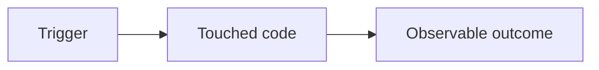

# Reviewer's 30-second read

<!-- 3 lines, no more. If the reader is still confused after this, the rest of the PR has failed them. -->

- **What changed:** [one sentence — user-observable behaviour or system change, not the mechanism]
- **Why:** [one sentence — the trigger or business reason; link the ticket if there is one]
- **Blast radius:** [one sentence — what surfaces / providers / generated modules could feel this if it breaks]

# What's this PR for?

<!-- For each meaningful change in this PR, use the Issue / Why / Example structure below.
     Small related edits can share one block; use as many numbered blocks as there are distinct changes.
     If there's a Jira/Trello card and/or write-up, link them here too. -->

**1. [Short name of the change]**

- **Issue:** [the user-observable problem — what breaks or hurts, and for whom]
- **Why:** [the root cause — the mechanism that produces the issue]
- **Example:** [a concrete scenario, ideally with real data, walking from the problem to how this change alters the outcome]

# What could this PR break and how are you going to ensure that those things do not break?

[Think about what this PR could possibly break, and list your thoughts here. Be sure to factor this into the testing plan below too, to ensure you're mitigating against all known risks.]

# Flow diagram

<!--
Required when ANY of the following are true:
  - the PR touches ≥ 3 source files (excluding tests / lockfiles)
  - the PR adds or removes a lifecycle hook, webhook route, or scaffolder output file
  - the PR introduces or changes a control-flow boundary the reviewer has to hold in their head (e.g. new state mapping, new branch in the scaffolder or spec reader, new error path)

If none apply, write `None` on its own line and move on.

When it applies, render a Mermaid diagram of the relevant flow. Aim for ≤ 10 nodes — show only the *changed* path or the *new* path, not the entire system. The point is to externalise the model the reviewer would otherwise have to reconstruct from the diff.
-->



# What's the testing plan?

[Detailed description of testing steps and test cases here. This should be in an easy-to-follow checklist format, and should include any pre-test steps (i.e., data setup). If steps are missing, the PR _will_ be rejected. The reviewer is expected to check off each item as they complete it.]

# Risk Assessment

- Probability of failure:
  - [ ] High
  - [ ] Low
- Impact:
  - [ ] High
  - [ ] Low
- Complexity:
  - [ ] High
  - [ ] Low

If any of the above are marked as high please include the below in your change log message:

```
This change has higher risk than usual, please take some time to test out the feature.
```

# Any environment variables to add?

- **[name]:** [description]

# Any migrations to run?

- **[name]:** [description]

# Any other dependencies for go-live?

- **[dependency]:** [description]

# Any documentation changes that need to be made?

- **[section]:** [description]

# Author checklist

- [ ] Have you assigned a reviewer and notified them?
- [ ] Have you handled all errors and edge cases? This includes proper `try/catch` blocks, and user-friendly error messages.
- [ ] Have you added sufficient logging? `LogService` only — no `console.log`.
- [ ] Have you written at least 1 test case for this code (if applicable)?
- [ ] Have you kept DI tokens and config fields provider-agnostic (`PROVIDER_CLIENT`, `providerSecretKey`)?
- [ ] Have you left a `TODO(human):` rather than guessing anywhere the provider docs or spec were ambiguous?
- [ ] Have you regenerated `llms-full.txt` with `npm run build:llms` if you touched any doc?
- [ ] Have you confirmed `npm test` and `npm run build` pass?

# Reviewer checklist

- [ ] The PR description adequately describes what this PR does and what it is for.
- [ ] All risks associated with these changes have been adequately identified and explained in the description.
- [ ] All risks associated with these changes have been adequately covered by either the testing plan, or code tests.
- [ ] All PR comments have been explicitly acknowledged and resolved.

# Post merge checklist

- [ ] Testing plan executed in sandbox
- [ ] Sandbox logs and slack channels reviewed
- [ ] Testing plan executed in production
- [ ] Production logs and slack channels reviewed
- [ ] #deployment-pipeline green ticked
- [ ] #changelog message posted
- [ ] I am hereby comfortable that this deployment is successfully completed
