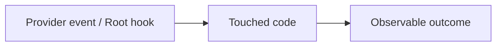

# Reviewer's 30-second read

<!-- 3 lines, no more. If the reader is still confused after this, the rest of the PR has failed them. -->

- **What changed:** [one sentence — user-observable behaviour or system change, not the mechanism]
- **Why:** [one sentence — the trigger or business reason; link the ticket if there is one]
- **Blast radius:** [one sentence — which policies / payments / provider calls could feel this if it breaks]

# What's this PR for?

<!-- For each meaningful change in this PR, use the Issue / Why / Example structure below.
     Small related edits can share one block; use as many numbered blocks as there are distinct changes.
     If there's a Jira/Trello card, a provider spec, or a write-up, link them here too. -->

**1. [Short name of the change]**

- **Issue:** [the user-observable problem — what breaks or hurts, and for whom]
- **Why:** [the root cause — the mechanism that produces the issue]
- **Example:** [a concrete scenario, ideally with a real payload or policy, walking from the problem to how this change alters the outcome]

# What could this PR break and how are you going to ensure that those things do not break?

<!-- Real risks only. Three terse bullets is usually plenty. Factor each into the testing plan below.
     For a collection module, the risks that actually bite are usually one of:
       - a webhook event that now routes somewhere else, or no longer routes at all
       - a status map change that writes a different Root payment status than before
       - a lifecycle hook that stopped being idempotent, so a Root retry double-charges or double-creates
       - a signature scheme or secret change that silently rejects (or silently accepts) live traffic
       - a provider error no longer mapped at the service boundary, so it escapes as a raw SDK error -->

# Flow diagram

<!--
Required when ANY of the following are true:
  - the PR touches ≥ 3 source files under `code/` (excluding tests / lockfiles)
  - the PR adds or removes a webhook event route, a lifecycle hook, or a controller
  - the PR introduces or changes a control-flow boundary the reviewer has to hold in their head
    (e.g. a new provider→Root status mapping, a new caller of an existing service method,
    a new branch in the webhook router)

If none apply, write `None` on its own line and move on.

When it applies, render a Mermaid diagram of the relevant flow. Aim for ≤ 10 nodes — show only the
*changed* path or the *new* path, not the whole module. The point is to externalise the model the
reviewer would otherwise have to reconstruct from the diff.
-->



# What's the testing plan?

<!-- An easy-to-follow checklist the reviewer ticks off. Include pre-test setup (config, fixtures,
     sandbox credentials). If steps are missing, the PR _will_ be rejected.

     Prefer checks that run locally and have an exit code over "deploy it and watch". For anything
     touching webhooks or lifecycle hooks, the simulator closes that loop offline:

       npm run sim:webhook   -- --event=<name>          # routes a signed fixture through the real handler
       npm run sim:webhook   -- --event=<name> --tamper # must reject, not accept
       npm run sim:lifecycle -- --hook=<name>           # invokes the real hook with a fixture
       npm run validate:provider                        # mechanical half of 14-SELF-REVIEW.md
       npm test && npm run build

     A green simulator run is not a working integration — it proves routing and verification, not that
     the provider sends what the fixture claims. Say which parts still need a sandbox. -->

# Risk Assessment

- Probability of failure:
  - [ ] High
  - [ ] Low
- Impact:
  - [ ] High
  - [ ] Low
- Complexity:
  - [ ] High
  - [ ] Low

If any of the above are marked as high please include the below in your change log message:

```
This change has higher risk than usual, please take some time to test out the feature.
```

# Any environment variables to add?

<!-- Fields added to `code/env.ts` (and therefore `code/env.sample.ts`), or keys in `.root-config.json`.
     Use the provider-agnostic names — `providerSecretKey`, `providerWebhookSigningSecret`, and so on.
     Note which are sandbox-only. `None` on its own line if there are none. -->

- **[name]:** [description]

# Any migrations to run?

<!-- Usually `None` for a collection module. If existing policies need backfilling in `app_data`
     (e.g. a renamed provider ID field), say exactly which policies and who runs it. -->

- **[name]:** [description]

# Any other dependencies for go-live?

<!-- Provider dashboard config the code can't set itself: webhook endpoint registered, events
     subscribed, API keys issued, IP allowlists. `None` on its own line if there are none. -->

- **[dependency]:** [description]

# Any documentation changes that need to be made?

<!-- Numbered docs in `collection_module/docs/`, the `CLAUDE.md` routing table, or the provider doc at
     `docs/providers/<slug>.md`. Remember `npm run build:llms` after any doc edit — `llms-full.txt` is
     checked in and drift breaks downstream agents. -->

- **[section]:** [description]

# Author checklist

- [ ] Have you run `/review-implementation` against `collection_module/docs/14-SELF-REVIEW.md`?
- [ ] Have you run `npm run validate:provider` and does it exit 0?
- [ ] Have you assigned a reviewer and notified them?
- [ ] Have you exercised every webhook event you touched with `npm run sim:webhook`, including `--tamper`?
- [ ] Have you exercised every lifecycle hook you touched with `npm run sim:lifecycle`, twice, to show it's idempotent?
- [ ] Are DI tokens and config fields provider-agnostic (`PROVIDER_CLIENT`, `providerSecretKey` — never `STRIPE_CLIENT`, `stripeSecretKey`)?
- [ ] Have you handled all errors and edge cases, mapping provider errors to an `EnhancedModuleError` subclass at the service boundary?
- [ ] Have you wrapped external calls in `retryWithBackoff`?
- [ ] Have you added sufficient logging via `LogService` — and no `console.log`?
- [ ] Have you written at least 1 test case for this code (if applicable)?
- [ ] Have you listed every `TODO(human):` you left, and every assumption the provider's docs didn't directly support?
- [ ] Have you run `npm run build:llms` if you touched any doc?

# Reviewer checklist

- [ ] The PR description adequately describes what this PR does and what it is for.
- [ ] All risks associated with these changes have been adequately identified and explained in the description.
- [ ] All risks associated with these changes have been adequately covered by either the testing plan, or code tests.
- [ ] All PR comments have been explicitly acknowledged and resolved.

# Post merge checklist

- [ ] Testing plan executed in sandbox (`npm run deploy:sandbox`)
- [ ] Sandbox logs and slack channels reviewed
- [ ] Testing plan executed in production (`npm run deploy:production`)
- [ ] Production logs and slack channels reviewed
- [ ] #deployment-pipeline green ticked
- [ ] #changelog message posted
- [ ] I am hereby comfortable that this deployment is successfully completed
